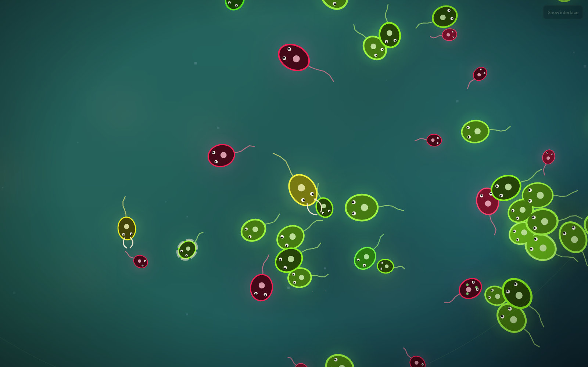
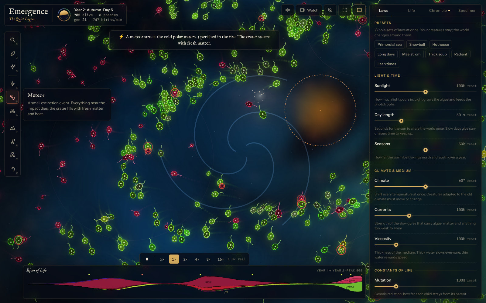
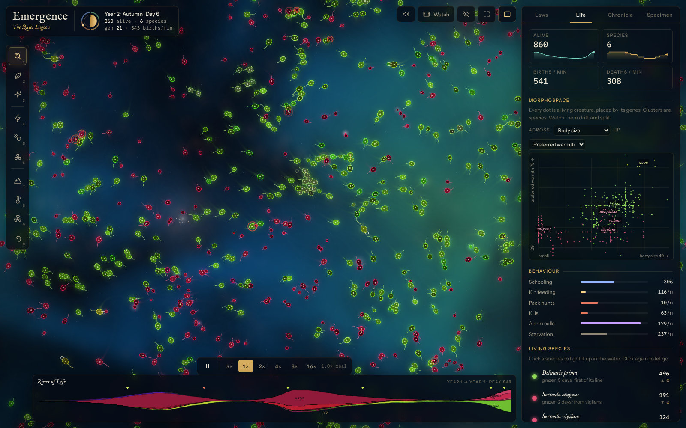
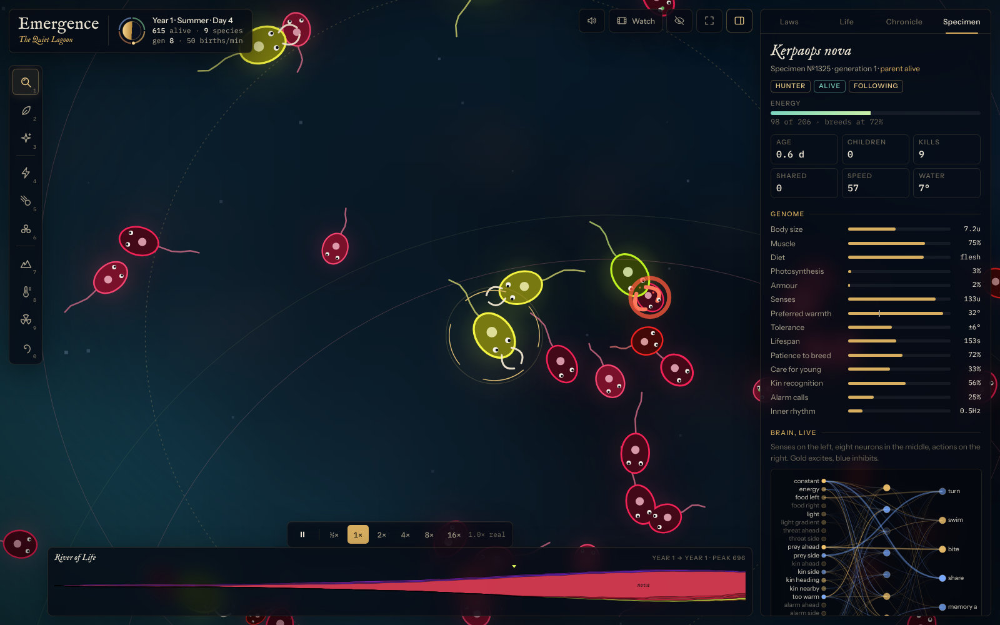
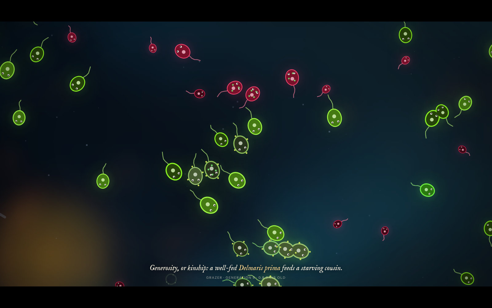

# Emergence

A tiny universe with its own laws of physics. Life sparks in it on its own, then evolves, competes and cooperates in real time, and you can bend the rules of its world like a curious god.
Kendi fizik yasaları olan minicik bir evren. Yaşam burada kendiliğinden başlıyor; canlılar gerçek zamanlı olarak evrimleşiyor, yarışıyor ve iş birliği yapıyor. Sen de meraklı bir tanrı gibi dünyanın kurallarını bükebiliyorsun.

**Live / Canlı sürüm:** https://erenciracioglu-dotcom.github.io/emergence/

[English](#english) · [Türkçe](#türkçe)

## English

A universe the size of a drop of water. A sun circles it once a day, the seasons swing a warm belt north and south, and slow currents stir the algae, the dissolved matter and anything too weak to swim. In rich, sunlit water the first cells spark into life. Each one carries sixteen genes and a small neural-network brain, and both change a little every time it divides.

Nothing in the code tells a creature to hunt in packs, swim in schools or feed a hungry sister. Those behaviours turn up when they pay, and fade when the world changes. You can sit back and watch, or reach in: drop a meteor, raise a wall of stone, turn up the sun, thicken the water, and see who adapts.

### The laws of this universe

- **Space** is a flat torus: swim off one edge and you come back on the other. Light, heat, algae, nutrients and carrion are fields on a 10-unit grid across it.
- **Light and time.** The sun circles the world once a day (a minute, by default), and an eight-day year swings the warm belt north and south. Clouds drift over.
- **Heat.** A warm equator, cold poles, warmer days, and hydrothermal vents as warm, rich oases. Every creature has a warmth it prefers and a range it tolerates, and its metabolism runs faster in the warm (the Q10 rule).
- **Water.** Swimming works against Stokes drag, which grows with body size, speed and viscosity. Slow, divergence-free gyres carry everything that drifts.
- **Matter is conserved.** Nutrients become algae, algae become bodies, bodies become carrion, and carrion returns to nutrients. Sunlight is the only source of energy, and metabolism scales with mass^0.75 (Kleiber's law).

### Life

- **Sixteen genes:** body size, muscle, diet (from grazer to hunter), photosynthesis, armour, senses, preferred warmth, warmth tolerance, lifespan, patience to breed, care for young, kin recognition, two pigment genes, alarm calls and an inner rhythm.
- **A brain** with 21 senses (food to the left and right, light and its gradient, threats, prey, kin and where they are heading, warmth, alarm calls, pain, a rhythm and two memory loops), 8 neurons and 6 actions (turn, swim, bite, share and the two memories), plus reflexes wired straight from senses to actions.
- **Ways to make a living:** graze algae, drink sunlight, scavenge carrion, or hunt. A bite grips the prey and drags it along; a hunter swallows anything less than 1/1.6 of its size whole, and then needs time to digest.
- **Living together.** Kin know each other by pigment colour. They pass energy to hungry relatives, school together (drafting behind one another and confusing hunters), raise alarms, and sometimes hunt in packs. Plagues rise in crowded colonies and spread by touch among close relatives; survivors become immune.
- **Species.** When a lineage drifts far enough from its parent's average genome it becomes a new species, with a Latin name: the genus of its root and an epithet from the trait that changed most. When prey abounds and nothing hunts it, the next spark of life may well be a hunter.

### Being a god

| Key | Tool | What it does |
|---|---|---|
| 1 | Observe | Click a creature to examine it. Drag to look around, scroll to zoom, double-click to zoom in. |
| 2 | Manna | Paint fresh algae into the water. The matter is drawn from the whole sea, so the total never changes. |
| 3 | Breathe life | Spark a new lineage where you click: any life, grazers, hunters or sun-drinkers. |
| 4 | Lightning | Strike down whatever lies under the bolt. Hold to keep striking. |
| 5 | Meteor | A small extinction event. Everything near the impact dies; the crater fills with fresh matter and heat. |
| 6 | Plague | Infect a creature and its kind nearby. It spreads by touch among close relatives. |
| 7 | Stone | Raise walls of rock. Populations cut off from each other drift apart into new species. |
| 8 | Climate | Paint heat or cold onto the water. It fades over about a minute. |
| 9 | Radiation | A mutagenic glow: children born inside it mutate up to eight times as much. |
| 0 | Forces | Whirlpools, gravity wells and repulsors that bend the currents. |

The **Laws** panel bends the universe itself: sunlight, day length, seasons, climate, currents, viscosity, mutation, entropy (the cost of staying alive), total matter, spontaneous life, pestilence and a population limit. Eight presets change many laws at once (Primordial sea, Snowball, Hothouse, Long days, Maelstrom, Thick soup, Radiant, Lean times). Your creatures stay; the world changes around them.

### Reading the story

- **Life** shows how the universe behaves (schooling, kin feeding, pack hunts, kills, alarm calls, starvation), a **morphospace** that places every species by two traits of your choice, the living species, and how the traits drift over time. Click a species to light it up in the water.
- The **River of Life** along the bottom draws every species' population through time, each new branch beside the lineage it split from.
- **Chronicle** writes the history as it happens: the first hunters, new species, extinctions, plagues, great dyings and your own interventions.
- **Specimen** opens a single creature: its genome and its brain, firing live, with buttons to follow it, find its parent, clone it, bless it or strike it down.
- **Watch** (D) hands the camera to a documentary director that follows hunts, schools, births, elders, plagues and new species, with captions.
- **Sound** (S) is a soft drone that follows the sun and the seasons, with small voices for births, deaths and wrath.

### Keys

| Key | |
|---|---|
| Click · drag · scroll | Examine · look around · zoom |
| 1–0 | God's tools |
| [ ] | Brush size |
| Space | Pause; hold and drag to look around with any tool |
| , . | Slower, faster (½× to 16×) |
| D | Watch mode |
| S | Sound |
| P | Show or hide the panel |
| H | Hide the whole interface |
| T | Trails |
| F | Follow the selected creature |
| + − · arrow keys | Zoom · pan |
| Esc | Stop watching, let go |

### Keeping a universe

Your universe is saved in the browser every minute, and the next visit offers to return to it. **Save as file** keeps it as a `.json` file you can open again later, and **Save a picture** saves the view as a PNG. **Big Bang** starts over from a seed: the same number makes the same sea, the same vents and the same first sparks.

### Running it

One HTML file, with no install and no server: open `index.html` in a current browser (Chrome, Edge, Firefox, Safari). It works on phones too, with the tools along the bottom and the panel as a sheet.

The source is in `src/`: `src/core` is the simulation, `src/ui` the renderer and the interface. `node build.js` puts it all together into `index.html`. `node tools/headless.js 600 42` runs ten simulated minutes of seed 42 without a browser and prints the ecology as it goes.

Plain JavaScript and Canvas 2D, with no libraries. A spatial hash finds neighbours, the fields are carried by the currents (semi-Lagrangian advection) and diffuse, drawing is batched by colour, and the resolution drops by itself on slow machines.

### About

Emergence was made by Claude (Anthropic) at Eren's request, October 2026. The design and the code are Claude's. When the page runs inside Claude as an artifact, the Chronicle also holds an **Oracle** you can ask about the history of your universe.

## Türkçe

Bir su damlası büyüklüğünde bir evren. Güneş onu günde bir kez dolaşıyor, mevsimler sıcak kuşağı kuzeye ve güneye savuruyor, yavaş akıntılar algleri, suda çözünmüş maddeyi ve yüzemeyecek kadar zayıf olan her şeyi sürüklüyor. Zengin ve güneşli sularda ilk hücreler kendiliğinden canlanıyor. Her birinin on altı geni ve küçük bir sinir ağından oluşan bir beyni var; ikisi de her bölünmede biraz değişiyor.

Kodun hiçbir yerinde canlılara sürüyle avlanmalarını, sürü hâlinde yüzmelerini ya da aç kardeşlerini beslemelerini söyleyen bir satır yok. Bu davranışlar işe yaradıklarında ortaya çıkıyor, dünya değişince de sönüp gidiyor. İstersen arkana yaslanıp izlersin, istersen elini uzatırsın: bir göktaşı düşür, taştan bir duvar ör, güneşi artır, suyu koyulaştır ve kimin uyum sağladığına bak.

### Bu evrenin yasaları

- **Uzay** kenarsız bir torustur: bir kenardan çıkan öbür kenardan geri girer. Işık, ısı, alg, besin ve leş, evreni kaplayan 10 birimlik bir ızgarada tutulan alanlardır.
- **Işık ve zaman.** Güneş dünyayı günde bir kez dolaşır (varsayılan olarak bir dakikada), sekiz günlük bir yıl da sıcak kuşağı kuzeye ve güneye savurur. Üstünden bulutlar geçer.
- **Isı.** Sıcak bir ekvator, soğuk kutuplar, daha ılık gündüzler ve sıcak, bereketli vahalar gibi hidrotermal bacalar. Her canlının sevdiği bir sıcaklık ve dayanabildiği bir aralık vardır; sıcakta metabolizması hızlanır (Q10 kuralı).
- **Su.** Yüzmek, beden büyüklüğü, hız ve viskoziteyle artan Stokes sürtünmesine karşı yapılır. Yavaş ve ıraksamasız girdaplar sürüklenen her şeyi taşır.
- **Madde korunur.** Besin alge, alg bedene, beden leşe, leş yeniden besine döner. Tek enerji kaynağı güneş ışığıdır; metabolizma kütlenin 0,75'inci kuvvetiyle ölçeklenir (Kleiber yasası).

### Yaşam

- **On altı gen:** beden büyüklüğü, kas, beslenme (otlayandan avcıya), fotosentez, zırh, duyular, sevilen sıcaklık, sıcaklık toleransı, ömür, üreme sabrı, yavruya özen, akraba tanıma, iki pigment geni, alarm çağrısı ve bir iç ritim.
- **Beyin:** 21 duyu (solda ve sağda yiyecek, ışık ve yönü, tehdit, av, akrabalar ve gittikleri yön, sıcaklık, alarm, acı, ritim ve iki bellek döngüsü), 8 nöron ve 6 eylem (dönmek, yüzmek, ısırmak, paylaşmak ve iki bellek); bir de duyulardan eylemlere doğrudan bağlı refleksler.
- **Geçim yolları:** alg otlamak, güneş içmek, leş yemek ya da avlanmak. Isırık avı kavrar ve sürükler; bir avcı, kendisinin 1/1,6'sından küçük her şeyi bütün olarak yutar, sonra sindirmek için zamana ihtiyaç duyar.
- **Birlikte yaşamak.** Akrabalar birbirini pigment renginden tanır. Aç akrabalarına enerji aktarırlar, sürü hâlinde yüzerler (birbirinin arkasında daha az yorulur, avcının kafasını karıştırırlar), alarm verirler ve bazen sürüyle avlanırlar. Kalabalık kolonilerde salgınlar çıkar ve yakın akrabalar arasında temasla yayılır; hayatta kalanlar bağışıklık kazanır.
- **Türler.** Bir soy, atasının ortalama genomundan yeterince uzaklaşınca yeni bir tür olur ve Latince bir ad alır: kökünün cins adı ve en çok değişen özelliğinden gelen bir tür sıfatı. Av bolsa ve onu avlayan yoksa, bir sonraki yaşam kıvılcımı pekâlâ bir avcı olabilir.

### Tanrı olmak

| Tuş | Araç | Ne yapar |
|---|---|---|
| 1 | Observe (gözle) | Bir canlıya tıklayıp incele. Sürükleyerek etrafa bak, tekerlekle yakınlaş, çift tıklayarak yaklaş. |
| 2 | Manna (kudret helvası) | Suya taze alg sür. Madde bütün denizden çekilir, toplam hiç değişmez. |
| 3 | Breathe life (can ver) | Tıkladığın yerde yeni bir soy başlat: her türden yaşam, otlayanlar, avcılar ya da güneş içenler. |
| 4 | Lightning (yıldırım) | Şimşeğin altında ne varsa yok et. Basılı tutunca vurmaya devam eder. |
| 5 | Meteor (göktaşı) | Küçük bir yok oluş. Çarpma yerinin çevresindeki her şey ölür; krater taze madde ve ısıyla dolar. |
| 6 | Plague (veba) | Bir canlıyı ve yakındaki türdeşlerini hasta et. Hastalık yakın akrabalar arasında temasla yayılır. |
| 7 | Stone (taş) | Taştan duvarlar ör. Birbirinden ayrılan topluluklar zamanla ayrı türlere dönüşür. |
| 8 | Climate (iklim) | Suya sıcak ya da soğuk sür. Bir dakika kadar içinde söner. |
| 9 | Radiation (radyasyon) | Mutasyona yol açan bir ışıma: içinde doğan yavrular sekiz kata kadar fazla mutasyona uğrar. |
| 0 | Forces (kuvvetler) | Akıntıları büken girdaplar, çekim kuyuları ve iticiler. |

**Laws** (yasalar) paneli evrenin kendisini büker: güneş ışığı, gün uzunluğu, mevsimler, iklim, akıntılar, viskozite, mutasyon, entropi (hayatta kalmanın bedeli), toplam madde, kendiliğinden yaşam, salgın ve nüfus sınırı. Sekiz hazır ayar birçok yasayı birden değiştirir (Primordial sea, Snowball, Hothouse, Long days, Maelstrom, Thick soup, Radiant, Lean times). Canlıların yerinde kalır, dünya onların etrafında değişir.

### Hikâyeyi okumak

- **Life** (yaşam) panelinde davranış göstergeleri (sürü hâlinde yüzme, akrabayı besleme, sürüyle av, öldürme, alarm, açlık), her türü seçtiğin iki özelliğe göre yerleştiren bir **morphospace** (biçim uzayı), yaşayan türler ve özelliklerin zaman içinde nasıl kaydığı var. Bir türe tıklayınca bütün bireyleri suda parlar.
- Alttaki **River of Life** (Hayat Nehri) her türün nüfusunu zaman içinde çizer; her yeni dal, ayrıldığı soyun hemen yanından akar.
- **Chronicle** (vakayiname) tarihi olurken yazar: ilk avcılar, yeni türler, yok oluşlar, salgınlar, büyük ölümler ve senin müdahalelerin.
- **Specimen** (örnek) tek bir canlıyı açar: genomu ve canlı canlı çalışan beyni; onu takip etmek, atasını bulmak, kopyalamak, kutsamak ya da yıldırımla vurmak için düğmeler.
- **Watch** (D, izleme) kamerayı bir belgesel yönetmenine bırakır: av sahnelerini, sürüleri, doğumları, yaşlıları, salgınları ve yeni türleri altyazılarıyla izler.
- **Sound** (S, ses) güneşi ve mevsimleri izleyen yumuşak bir uğultu; doğumlar, ölümler ve gazap için küçük sesler.

### Kısayollar

| Tuş | |
|---|---|
| Tıkla · sürükle · tekerlek | İncele · etrafa bak · yakınlaş |
| 1–0 | Tanrının araçları |
| [ ] | Fırça boyu |
| Boşluk | Duraklat; basılı tutup sürükleyince her araçla etrafa bakılır |
| , . | Yavaşlat, hızlandır (½× ile 16× arası) |
| D | İzleme modu |
| S | Ses |
| P | Paneli aç, kapat |
| H | Bütün arayüzü gizle |
| T | İzler |
| F | Seçili canlıyı takip et |
| + − · ok tuşları | Yakınlaş · kaydır |
| Esc | İzlemeyi bitir, bırak |

### Evreni saklamak

Evrenin her dakika tarayıcına kaydedilir; bir sonraki gelişinde kaldığın yere dönmeyi önerir. **Save as file** onu sonra yeniden açabileceğin bir `.json` dosyası olarak saklar, **Save a picture** da görüntüyü PNG olarak kaydeder. **Big Bang** (Büyük Patlama) her şeyi bir tohum sayısından yeniden başlatır: aynı sayı aynı denizi, aynı bacaları ve aynı ilk kıvılcımları verir.

### Çalıştırma

Tek bir HTML dosyası; kurulum ya da sunucu gerekmez: `index.html` dosyasını güncel bir tarayıcıda (Chrome, Edge, Firefox, Safari) açman yeterli. Telefonda da çalışır; araçlar alta iner, panel aşağıdan açılan bir sayfaya dönüşür.

Kaynak kod `src/` klasöründe: `src/core` simülasyon, `src/ui` çizim ve arayüz. `node build.js` hepsini `index.html` içinde birleştirir. `node tools/headless.js 600 42` 42 numaralı tohumla on dakikalık simülasyonu tarayıcı olmadan çalıştırır ve ekolojiyi adım adım yazdırır.

Düz JavaScript ve Canvas 2D; kütüphane yok. Komşuları uzamsal bir karma tablosu bulur, alanlar akıntılarla taşınır (yarı-Lagrange adveksiyon) ve yayılır, çizim renklere göre toplu yapılır ve yavaş makinelerde çözünürlük kendiliğinden düşer.

### Hakkında

Emergence, Eren'in isteğiyle Claude'un (Anthropic) yaptığı bir evren, Ekim 2026. Tasarım ve kod Claude'a ait. Sayfa Claude'un içinde bir artifact olarak çalıştığında, Chronicle panelinde evreninin tarihini sorabileceğin bir **Oracle** (kâhin) da bulunur.

## License / Lisans

MIT. See [LICENSE](LICENSE). [LICENSE](LICENSE) dosyasına bakın.
